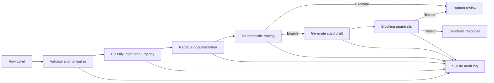

# Customer Success Agent

An auditable customer-support automation system that classifies tickets, retrieves relevant documentation, applies deterministic routing rules, generates cited responses, runs blocking safety guardrails, and persists every important decision.

Supported channels: email, chat, documentation comments, and forum posts.

## Architecture



A response is sendable only when `may_send_response` is `true`. High model confidence cannot override mandatory escalation, weak retrieval, the kill switch, or a failed guardrail.

## Safety behavior

- Security, compliance, feature, and unclear requests require human review.
- Low-confidence classification and weak retrieval escalate.
- Prompt injection, sensitive output, unsupported claims, invalid citations, and unauthorized commitments block delivery.
- Blocked drafts are never returned as sendable answers.
- API and dependency failures fail closed.
- `KILL_SWITCH=true` disables every automatic response.
- Ticket content and customer identifiers are never used as Prometheus labels.
- Each processed ticket receives a persistent terminal outcome.

## Project structure

```text
Customer_Success_Agent/
|-- artifacts/
|   `-- ticket_classifier.joblib
|-- data/
|   |-- documentation.json
|   `-- smoke_ticket.json
|-- docs/
|   |-- architecture.md
|   `-- implementation_plan.md
|-- evaluation/
|   |-- harness.py
|   `-- results/
|-- prompts/
|   |-- README.md
|   `-- response_generator_v1.txt
|-- scripts/
|   `-- validate.ps1
|-- src/
|   |-- api.py
|   |-- app.py
|   |-- build.py
|   |-- classify.py
|   |-- config.py
|   |-- evaluate.py
|   |-- generate.py
|   |-- guardrails.py
|   |-- ingest.py
|   |-- logging_store.py
|   |-- metrics.py
|   |-- models.py
|   |-- retrieve.py
|   |-- route.py
|   |-- run.py
|   `-- workflow.py
|-- storage/
|   |-- chroma/
|   `-- decisions.db
|-- tests/
|-- .env.example
|-- pyproject.toml
|-- requirements.txt
`-- README.md
```

## Requirements

- Windows x64 or macOS
- CPython 3.11
- PowerShell on Windows, or zsh/bash on macOS
- An OpenRouter API key for real response generation
- Internet access for dependency installation and the first embedding-model download

Unit tests use injected fakes and do not require OpenRouter.

## Setup

Run commands from the project root.

### Windows PowerShell

```powershell
cd "C:\path\to\Customer_Success_Agent"
py -3.11 -m venv .venv
.\.venv\Scripts\Activate.ps1
python -m pip install --upgrade pip setuptools wheel
python -m pip install --no-cache-dir -r .\requirements.txt
python -m pip check
```

If script execution is blocked:

```powershell
Set-ExecutionPolicy -Scope Process -ExecutionPolicy Bypass
.\.venv\Scripts\Activate.ps1
```

### macOS Terminal

```bash
cd "/path/to/Customer_Success_Agent"
python3.11 -m venv .venv
source .venv/bin/activate
python -m pip install --upgrade pip setuptools wheel
python -m pip install --no-cache-dir -r requirements.txt
python -m pip check
```

If Python 3.11 is unavailable and Homebrew is installed:

```bash
brew install python@3.11
```

On either platform, verify the interpreter:

```bash
python --version
python -c "import sys; print(sys.executable)"
```

The version must be Python 3.11.

## Configuration

Create the private environment file.

Windows:

```powershell
Copy-Item .env.example .env
```

macOS:

```bash
cp .env.example .env
```

Set your key in `.env`:

```dotenv
OPENROUTER_API_KEY=your_real_key
```

Important settings:

| Variable                    | Purpose                       | Default                              |
| --------------------------- | ----------------------------- | ------------------------------------ |
| `OPENROUTER_API_KEY`      | OpenRouter credential         | Required for generation              |
| `MODEL_NAME`              | OpenRouter model              | `meta-llama/llama-3.1-8b-instruct` |
| `EMBEDDING_MODEL`         | Local embedding model         | `all-MiniLM-L6-v2`                 |
| `CONFIDENCE_THRESHOLD`    | Minimum classifier confidence | `0.83`                             |
| `RETRIEVAL_THRESHOLD`     | Minimum retrieval relevance   | `0.45`                             |
| `RETRIEVAL_TOP_K`         | Passages retained as context  | `5`                                |
| `RETRIEVAL_CANDIDATE_MULTIPLIER` | Candidate-pool multiplier before document deduplication | `3` |
| `CHUNK_MAX_CHARACTERS`    | Maximum documentation chunk size | `500`                           |
| `CHUNK_OVERLAP_CHARACTERS` | Overlap for split sections    | `120`                              |
| `KILL_SWITCH`             | Disable automatic responses   | `false`                            |
| `REQUEST_TIMEOUT_SECONDS` | Provider timeout              | `30`                               |
| `MAX_RETRIES`             | Provider retries              | `3`                                |
| `CHROMA_PATH`             | Persistent vector index       | `./storage/chroma`                 |
| `DATABASE_URL`            | Decision database             | `sqlite:///./storage/decisions.db` |

Never commit `.env`.

## Prepare reusable artifacts

The repository includes the trusted classifier artifact needed by a clean
checkout. Build the local Chroma index and initialize runtime storage once:

```bash
python -m src.build
```

The first build may download the configured embedding model. Subsequent
application runs reuse the persisted index and classifier.

Confirm the classifier loads:

```bash
python -c "from src.classify import TicketClassifier; TicketClassifier.load('artifacts/ticket_classifier.joblib'); print('classifier loaded')"
```

### Optional classifier retraining

Retraining is required only after changing classifier code, training data, or
the pinned scikit-learn version. The supplied development dataset is not part
of the source repository; pass its path explicitly when it is available.

Windows:

```powershell
python -m src.build `
  --training-data "C:\path\to\development_tickets.json" `
  --rebuild-classifier
```

macOS:

```bash
python -m src.build \
  --training-data "/path/to/development_tickets.json" \
  --rebuild-classifier
```

## Test retrieval

This builds or reuses the persistent Chroma collection without calling OpenRouter:

```bash
python -X faulthandler -c "from src.config import get_settings, ensure_runtime_directories; from src.retrieve import load_and_chunk_corpus, ChromaRetriever; s=get_settings(); ensure_runtime_directories(s); passages=load_and_chunk_corpus(s.data_dir / 'documentation.json'); r=ChromaRetriever(chroma_path=s.chroma_path, embedding_model_name=s.embedding_model); print(r.build_index(passages)); print([(m.passage_id, round(m.relevance_score, 3)) for m in r.search('How do I reset my password?', top_k=3)]); print('CHROMA TEST PASSED')"
```

The first run may download the embedding model.

## Tests and coverage

These commands are identical on Windows and macOS:

```bash
python -m pytest -q
```

Run one file:

```bash
python -m pytest tests/test_workflow.py -v
```

Run with terminal and XML coverage:

```bash
python -m pytest --cov=src --cov=evaluation --cov-report=term-missing --cov-report=xml
```

Generate HTML coverage:

```bash
python -m pytest --cov=src --cov=evaluation --cov-report=html
```

Windows opens the report with:

```powershell
Start-Process .\evaluation\results\coverage_html\index.html
```

macOS opens it with:

```bash
open evaluation/results/coverage_html/index.html
```

## One-command validation

Windows:

```powershell
.\scripts\validate.ps1
```

If local scripts are blocked:

```powershell
powershell -ExecutionPolicy Bypass -File .\scripts\validate.ps1
```

Faster validation without coverage:

```powershell
.\scripts\validate.ps1 -SkipCoverage
```

Run offline checks followed by real evaluation:

```powershell
.\scripts\validate.ps1 -RunEvaluation
```

On macOS, use the individual test, artifact, corpus, and evaluation commands in this README. A matching `scripts/validate.sh` can be used when present.

## Process a ticket file

Windows:

```powershell
python -m src.run `
  --input .\data\validation_tickets.json `
  --output .\evaluation\results\validation_run.json `
  --pretty
```

macOS:

```bash
python -m src.run \
  --input ./data/validation_tickets.json \
  --output ./evaluation/results/validation_run.json \
  --pretty
```

CLI exit codes:

|  Code | Meaning                                           |
| ----: | ------------------------------------------------- |
| `0` | Run completed                                     |
| `1` | Expected input, configuration, or startup failure |
| `2` | Unexpected infrastructure failure                 |

## Evaluate a completed run

Windows:

```powershell
python -m src.evaluate `
  --tickets .\data\validation_tickets.json `
  --run-report .\evaluation\results\validation_run.json `
  --output .\evaluation\results\validation_metrics.json `
  --pretty
```

macOS:

```bash
python -m src.evaluate \
  --tickets ./data/validation_tickets.json \
  --run-report ./evaluation/results/validation_run.json \
  --output ./evaluation/results/validation_metrics.json \
  --pretty
```

Metrics include intent and urgency accuracy, routing accuracy, unsafe auto-responses, expected-document retrieval, citation coverage, latency, outcomes, and per-channel accuracy.

## Full evaluation harness

The command is the same on Windows and macOS:

```bash
python -m evaluation.harness
```

The harness always reuses the persistent index prepared by
`python -m src.build`; it does not rebuild the index during evaluation.

Outputs:

```text
evaluation/results/validation_run.json
evaluation/results/validation_metrics.json
evaluation/results/validation_summary.json
```

Harness exit codes:

|  Code | Meaning                                  |
| ----: | ---------------------------------------- |
| `0` | Completed and all critical checks passed |
| `1` | Operational failure                      |
| `3` | Safety or reconciliation check failed    |

Real runs can make multiple OpenRouter requests and consume API credits.

## API service

Start the service on either platform:

```bash
python -m src.api
```

Endpoints:

| Endpoint                  | Purpose                                |
| ------------------------- | -------------------------------------- |
| `GET /health`           | Liveness without model initialization  |
| `GET /ready`            | Load dependencies and report readiness |
| `POST /tickets/process` | Process one ticket                     |
| `GET /metrics`          | Prometheus metrics                     |
| `GET /docs`             | Interactive OpenAPI documentation      |

### Windows API examples

```powershell
Invoke-RestMethod -Uri http://127.0.0.1:8000/health
Invoke-RestMethod -Uri http://127.0.0.1:8000/ready
```

```powershell
$ticket = @{
  ticket_id = "WIN-001"
  channel = "email"
  subject = "Cannot log in"
  body = "My credentials are rejected when I access the console."
} | ConvertTo-Json

Invoke-RestMethod `
  -Uri http://127.0.0.1:8000/tickets/process `
  -Method Post `
  -ContentType "application/json" `
  -Headers @{ "X-Run-ID" = "WINDOWS-MANUAL-RUN" } `
  -Body $ticket
```

### macOS API examples

```bash
curl --silent http://127.0.0.1:8000/health | python -m json.tool
curl --silent http://127.0.0.1:8000/ready | python -m json.tool
```

```bash
curl --silent \
  --request POST \
  --url http://127.0.0.1:8000/tickets/process \
  --header 'Content-Type: application/json' \
  --header 'X-Run-ID: MACOS-MANUAL-RUN' \
  --data '{
    "ticket_id": "MAC-001",
    "channel": "email",
    "subject": "Cannot log in",
    "body": "My credentials are rejected when I access the console."
  }' | python -m json.tool
```

The caller must check `may_send_response` before delivering any answer.

## Prometheus metrics

Windows:

```powershell
Invoke-WebRequest -Uri http://127.0.0.1:8000/metrics |
  Select-Object -ExpandProperty Content
```

macOS:

```bash
curl --silent http://127.0.0.1:8000/metrics
```

Exported metrics include ticket outcomes, workflow latency, classifier confidence, retrieval relevance, guardrail blocks, stage failures, HTTP requests, and readiness. They never contain ticket or customer identifiers.

## Audit logging

SQLite audit data is stored at `storage/decisions.db`. It records stage decisions, predictions, confidence, sources, thresholds, routing reasons, guardrails, model versions, terminal outcomes, latency, and errors. Ticket text is correlated using SHA-256 hashes rather than duplicated into every event.

## Dataset roles

- `development_tickets.json`: classifier training and development.
- `validation_tickets.json`: local end-to-end validation.
- `documentation.json`: trusted retrieval corpus.
- Hidden evaluator data: accepted through the generic `--input` interface.

Ground-truth labels are used only for training and evaluation. Routing does not inspect them.

## Attribution and AI assistance

AI assistance was used to explain errors, draft and review implementation
changes, and identify test gaps. Every retained change was reviewed through
local tests and measured evaluation runs. The final architecture choices,
threshold decisions, safety trade-offs, and interpretation of results remain
the project author's responsibility. Third-party libraries are listed and
pinned in `requirements.txt`.

## Troubleshooting

### Ticket file does not exist

Run commands from the project root or pass an absolute path.

### Backslashes break a Python path

Use forward slashes inside Python strings:

```python
TicketClassifier.load("artifacts/ticket_classifier.joblib")
```

### Windows exit code `-1073741819`

This is native access violation `0xC0000005`. Recreate the Python 3.11 environment from the pinned requirements and run:

```bash
python -X faulthandler -c "import numpy; import scipy; import sklearn; import torch; import sentence_transformers; import chromadb; print('imports passed')"
```

### No result file

Reports are written after successful completion. Inspect the terminal error and exit code.

Windows:

```powershell
Write-Host $LASTEXITCODE
```

macOS:

```bash
echo $?
```

### Classifier artifact incompatibility

Retrain the artifact using the currently installed scikit-learn version.

### Empty Chroma directory

This is valid immediately after clearing the generated index. Rebuild it
before running the application or evaluation harness:

```bash
python -m src.build --rebuild-index
```

### Disable all automatic responses

Set the following and restart the process:

```dotenv
KILL_SWITCH=true
```

## Development principles

- Deterministic safety decisions around probabilistic models
- Fail-closed behavior
- Explicit terminal outcomes
- No silent ticket drops
- Structured citations
- Persistent audit records
- Privacy-safe metrics
- Dependency injection for offline tests
- One-command testing and evaluation
